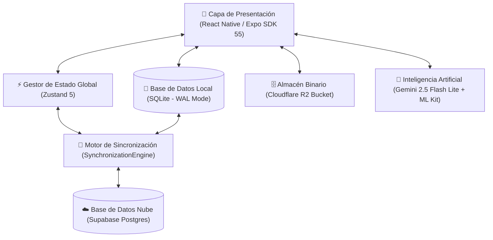
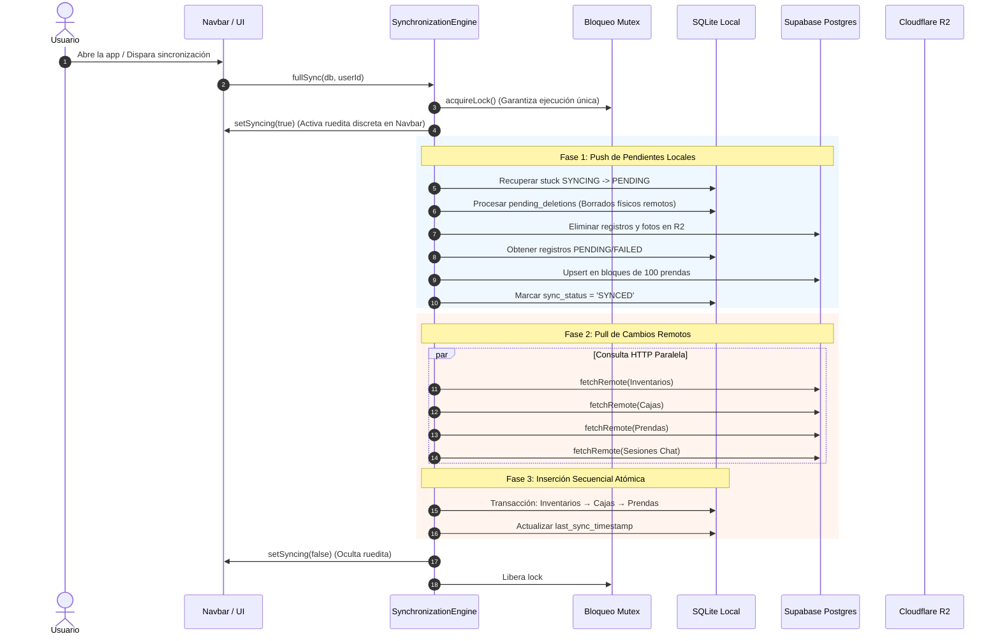

# Manual de Arquitectura Técnica — Topytop Kith

## 1. Visión General del Sistema

**Topytop Kith** es una solución móvil de grado industrial para la gestión y trazabilidad de inventarios textiles en tiempo real. Diseñada específicamente para plantas de producción, almacenes y auditorías de prendas, su premisa fundamental es la **resiliencia total ante la pérdida de conectividad** (*Offline-First*).



---

## 2. Filosofía y Ciclo de Vida *Offline-First*

A diferencia de las aplicaciones cliente-servidor tradicionales que dependen de solicitudes HTTP constantes, Topytop Kith opera sobre el principio de **localidad de datos**:

1. **Lectura Instantánea:** Todas las pantallas (`InventoriesScreen`, `BoxesScreen`, `BoxContentsScreen`, `StatsScreen`, `HistoryScreen`) consultan directamente la base de datos local SQLite. La interfaz responde en menos de **16 milisegundos** (60-120 FPS constantes).
2. **Escritura No Bloqueante:** Al crear, modificar o mover prendas y cajas, los cambios se persisten inmediatamente en SQLite marcados con el estado `sync_status = 'PENDING'`.
3. **Sincronización en Segundo Plano:** El motor de sincronización (`SynchronizationEngine`) se ejecuta sin bloquear la navegación del usuario. Cuando hay conexión a internet, los cambios locales se envían a Supabase y las actualizaciones remotas se integran atómicamente.
4. **Respaldo de Seguridad Local (`sync_safety_snapshots`):** Si un usuario cierra sesión con cambios pendientes sin conexión, los datos locales se respaldan en una instantánea aislada para garantizar que nunca se pierdan prendas o auditorías físicas.

---

## 3. Motor de Sincronización (`SynchronizationEngine`)

El motor de sincronización implementa el **Patrón Adapter** (`SyncAdapter`), permitiendo que cada entidad del dominio gestione sus propias transformaciones y resoluciones de conflictos.

### 3.1. Adaptadores Registrados
* `InventorySyncAdapter`: Gestiona lotes e inventarios principales.
* `BoxSyncAdapter`: Gestiona cajas físicas y su orden secuencial.
* `GarmentSyncAdapter`: Gestiona prendas textiles, tallas, colores y códigos OP.
* `ChatSessionSyncAdapter`: Sincroniza sesiones de conversación con el asistente IA.
* `ChatHistorySyncAdapter`: Sincroniza el historial de mensajes y consultas.

### 3.2. Flujo de Sincronización Completa (`fullSync`)



### 3.3. Mecanismos de Alta Disponibilidad y Resiliencia
* **Mutex Concurrente (`acquireLock`):** Evita colisiones si se dispara un pull manual mientras corre una sincronización automática en segundo plano.
* **Procesamiento por Lotes (*Chunking* de 100):** Para evitar que Supabase aborte solicitudes masivas por *Payload Too Large* o *Gateway Timeout*, las prendas se envían y reciben en lotes de 100 unidades con un tiempo límite de seguridad de 12 segundos por bloque (`Promise.race`).
* **Auto-Recuperación de Estados Colgados:** Si la aplicación se cerró abruptamente mientras un registro estaba en `SYNCING`, al arrancar se ejecuta `recoverStuckSyncing()` convirtiendo automáticamente los registros a `PENDING` para su reintento inmediato.

---

## 4. Arquitectura de Estado Global (`useAppStore` con Zustand 5)

La aplicación utiliza un almacén global reactivo y modularizado mediante **Zustand**:

```text
useAppStore
├── Configuración de Tema (themeMode, colorScheme, currentTheme)
├── Estado de Autenticación (user, session, userProfile, userRoles, isAccountActive)
├── Estado de Sincronización (isSyncing, syncMessage, lastSyncTime, isOnline)
├── Reactividad de Colecciones (inventories, garments, selectedGarments)
└── Estado de Onboarding (hasCompletedOnboarding)
```

### Principios de Reactividad
1. **Selectores Específicos:** Los componentes consumen solo los atributos requeridos (`state => state.currentTheme`, `state => state.isSyncing`) evitando renders innecesarios en árboles profundos.
2. **Separación de Persistencia:** Los temas y credenciales se guardan en `AsyncStorage` y la tabla `app_settings` de SQLite, asegurando que al reabrir la app el tema y el estado del usuario se restauren antes del primer pintado en pantalla.

---

## 5. Arquitectura de Navegación (React Navigation v7)

La navegación sigue una topología jerárquica:

* **`AppNavigator` / `AppNavigation`:** Contenedor maestro con soporte para tema dinámico claro/oscuro.
  * **`MainTabs` (Pestañas Inferiores):**
    * `Home` (`StatsScreen`): Dashboard de métricas y resumen de operaciones.
    * `Inventories` (`InventoriesScreen`): Gestión de lotes de trabajo activos.
    * `History` (`HistoryScreen`): Trazabilidad de prendas y auditoría cronológica.
    * `Chatbot` (`ChatbotScreen`): Asistente de lenguaje natural para búsqueda de prendas.
    * `Settings` (`SettingsScreen`): Centro de configuración, temas, gestión de roles y migraciones.
  * **Pila Principal (`MainStack`):**
    * `BoxesScreen`: Visualización de cajas dentro de un lote específico.
    * `BoxContentsScreen`: Listado de prendas, filtros de color/talla y visor de fotografías.
    * `FormScreen`: Formulario multifuncional (creación de lotes, cajas o prendas con OCR).
    * `TrashScreen`: Papelera de reciclaje y restauración de elementos.
    * `OnboardingScreen`: Pantalla de bienvenida para nuevos usuarios.

---

## 6. Sistema de Diseño (Claymorphism & Neumorphism)

La interfaz gráfica implementa un lenguaje visual moderno con estética *Claymorphism*:
* **Superficies Suaves y Bordes Táctiles:** Elevaciones sutiles (`clayStyles`) mediante sombras dobles (`shadowOffset`, `shadowRadius`, `borderWidth: 1`).
* **6 Esquemas Cromáticos:** Púrpura corporativo (`morado`), Dorado (`dorado`), Celeste (`celeste`), Esmeralda (`verde`), Rosa (`rosado`) y Rubí (`rojo`).
* **Soporte Nativo Dark Mode:** Fondo `#090A0F`, tarjetas `#161821` y bordes translúcidos con contraste visual optimizado para pantallas OLED.
