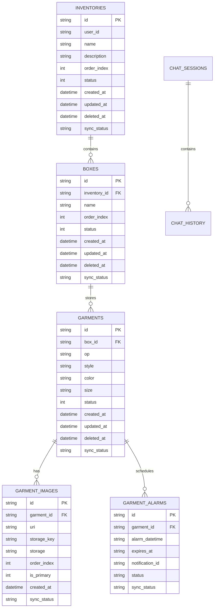

# Manual de Base de Datos y Esquemas — Topytop Kith

## 1. Arquitectura de Almacenamiento Local (SQLite)

La aplicación utiliza la biblioteca oficial de alto rendimiento `expo-sqlite` (versión 55). Cada dispositivo móvil aloja una base de datos embebida llamada `inventario.db`.

### 1.1. Configuraciones PRAGMA de Alto Rendimiento
Al inicializar la aplicación a través de `migrateDbIfNeeded`, se configuran directivas a nivel de motor SQLite:
```sql
PRAGMA journal_mode = WAL;
PRAGMA foreign_keys = ON;
```
* **WAL Mode (Write-Ahead Logging):** Permite lecturas concurrentes sin bloquear las operaciones de escritura. Esto asegura que la interfaz de usuario nunca se congele mientras el motor de sincronización escribe lotes en segundo plano.
* **Foreign Keys ON:** Garantiza la integridad referencial relacional entre Lotes, Cajas, Prendas, Imágenes y Alarmas.

---

## 2. Esquema Canónico Local (SQLite v3)



---

## 3. Diccionario de Datos de Tablas Locales

### 3.1. `app_settings`
Almacena preferencias del dispositivo de forma persistente y síncrona.
| Columna | Tipo | Clave | Descripción |
| :--- | :--- | :---: | :--- |
| `key` | `TEXT` | PK | Nombre de la configuración (`themeMode`, `colorScheme`). |
| `value` | `TEXT` | - | Valor asociado (`light`/`dark`, nombre del esquema). |

### 3.2. `inventories` (Lotes de Trabajo)
Representa una campaña, orden de producción o lote general de prendas textiles.
| Columna | Tipo | Restricción | Descripción |
| :--- | :--- | :--- | :--- |
| `id` | `TEXT` | PK NOT NULL | Identificador único UUID v4. |
| `user_id` | `TEXT` | Nullable | ID del usuario propietario en Supabase. |
| `name` | `TEXT` | NOT NULL | Nombre comercial del lote (ej. "Lote Invierno 2026"). |
| `description` | `TEXT` | Nullable | Notas adicionales u observaciones operativas. |
| `order_index` | `INTEGER` | DEFAULT 0 | Posición manual en listas reordenables. |
| `status` | `INTEGER` | DEFAULT 1 | 1 = Activo, 0 = Inactivo / Cerrado. |
| `created_at` | `TEXT` | DEFAULT (now) | Marca de tiempo ISO-8601 de creación. |
| `updated_at` | `TEXT` | Nullable | Marca de tiempo ISO-8601 de última edición. |
| `deleted_at` | `TEXT` | Nullable | Borrado lógico: si existe fecha, está en papelera. |
| `sync_status` | `TEXT` | DEFAULT 'PENDING' | Estado: `PENDING`, `SYNCING`, `SYNCED`, `FAILED`. |

### 3.3. `boxes` (Cajas Físicas)
Contenedores físicos que albergan las prendas dentro de un lote.
| Columna | Tipo | Restricción | Descripción |
| :--- | :--- | :--- | :--- |
| `id` | `TEXT` | PK NOT NULL | Identificador único UUID v4. |
| `inventory_id` | `TEXT` | FK NOT NULL | Referencia a `inventories(id) ON DELETE CASCADE`. |
| `name` | `TEXT` | NOT NULL | Nombre o código de la caja (ej. "Caja 01", "C-204"). |
| `order_index` | `INTEGER` | DEFAULT 0 | Orden para listas y ordenamiento drag-and-drop. |
| `status` | `INTEGER` | DEFAULT 1 | 1 = Activa, 0 = Inactiva. |
| `sync_status` | `TEXT` | DEFAULT 'PENDING' | Estado de sincronización en la nube. |

### 3.4. `garments` (Prendas Textiles)
Unidad atómica del inventario textil.
| Columna | Tipo | Restricción | Descripción |
| :--- | :--- | :--- | :--- |
| `id` | `TEXT` | PK NOT NULL | Identificador único UUID v4. |
| `box_id` | `TEXT` | FK NOT NULL | Referencia a `boxes(id) ON DELETE CASCADE`. |
| `op` | `TEXT` | Nullable | Orden de Producción / Lote textil (ej. "20459"). |
| `style` | `TEXT` | NOT NULL | Código de Estilo textil (ej. "KH001 202", "KH 501"). |
| `color` | `TEXT` | NOT NULL | Nombre del color normalizado en mayúsculas (ej. "AZUL NOCHE"). |
| `size` | `TEXT` | Nullable | Talla de la prenda (ej. "M", "L", "32", "S"). |
| `status` | `INTEGER` | DEFAULT 1 | 1 = Escaneada/Activa, 0 = Pendiente de validar. |
| `deleted_at` | `TEXT` | Nullable | Marca de borrado para papelera de reciclaje. |
| `sync_status` | `TEXT` | DEFAULT 'PENDING' | Estado de sincronización en la nube. |

### 3.5. `garment_images` (Fotografías y Almacenamiento)
Registros de evidencia visual asociados a cada prenda (hasta 2 por prenda).
| Columna | Tipo | Restricción | Descripción |
| :--- | :--- | :--- | :--- |
| `id` | `TEXT` | PK NOT NULL | Identificador único UUID v4. |
| `garment_id` | `TEXT` | FK NOT NULL | Referencia a `garments(id) ON DELETE CASCADE`. |
| `uri` | `TEXT` | Nullable | Ruta del archivo en almacenamiento local (`file://`). |
| `storage_key`| `TEXT` | Nullable | Clave de objeto en Cloudflare R2 (`prendas/...jpg`). |
| `storage` | `TEXT` | DEFAULT 'LOCAL' | Tipo de ubicación: `LOCAL`, `CLOUD`, `BOTH`. |
| `order_index`| `INTEGER` | DEFAULT 0 | 0 = Foto principal (slot 1), 1 = Foto secundaria (slot 2). |
| `is_primary` | `INTEGER` | DEFAULT 0 | 1 si es la miniatura principal de la tarjeta. |

### 3.6. `garment_alarms` (Alarmas y Recordatorios)
Recordatorios locales programados mediante el sistema de notificaciones del dispositivo.
| Columna | Tipo | Restricción | Descripción |
| :--- | :--- | :--- | :--- |
| `id` | `TEXT` | PK NOT NULL | Identificador único UUID v4. |
| `garment_id` | `TEXT` | FK NOT NULL | Referencia a `garments(id) ON DELETE CASCADE`. |
| `alarm_datetime` | `TEXT` | NOT NULL | Fecha y hora ISO-8601 programada para sonar. |
| `notification_id` | `TEXT` | Nullable | ID del canal nativo de `expo-notifications`. |
| `status` | `TEXT` | DEFAULT 'PENDING'| `PENDING`, `TRIGGERED`, `EXPIRED`, `DISMISSED`. |

### 3.7. `pending_deletions` (Cola de Borrados Físicos)
Registra las solicitudes de eliminación física diferida cuando el usuario borra permanentemente un elemento sin conexión a internet.
| Columna | Tipo | Descripción |
| :--- | :--- | :--- |
| `id` | `TEXT` PK | UUID único de la orden de borrado. |
| `tableName` | `TEXT` | Nombre de la tabla destino (`inventories`, `boxes`, `garments`, `garment_images`). |
| `recordId` | `TEXT` | ID del registro a destruir en Supabase y Cloudflare R2. |
| `createdAt` | `TEXT` | Fecha y hora de encolamiento. |

### 3.8. `sync_safety_snapshots` (Respaldo Anti-Pérdida de Datos)
Guarda un volcado JSON comprimido de los datos no sincronizados de un usuario si este cierra sesión sin internet, permitiendo restaurarlos al reconectar o cambiar de cuenta.

---

## 4. Estrategia de Índices de Alto Rendimiento

Para garantizar búsquedas instantáneas y filtrado a 60 FPS sobre bases de datos con miles de prendas, se definen los siguientes índices:

```sql
-- Lotes y Cajas
CREATE INDEX IF NOT EXISTS idx_inventories_user ON inventories(user_id);
CREATE INDEX IF NOT EXISTS idx_inventories_del ON inventories(deleted_at);
CREATE INDEX IF NOT EXISTS idx_inventories_sync ON inventories(sync_status);
CREATE INDEX IF NOT EXISTS idx_boxes_inventory ON boxes(inventory_id);
CREATE INDEX IF NOT EXISTS idx_boxes_del ON boxes(deleted_at);
CREATE INDEX IF NOT EXISTS idx_boxes_sync ON boxes(sync_status);

-- Prendas
CREATE INDEX IF NOT EXISTS idx_garments_box ON garments(box_id);
CREATE INDEX IF NOT EXISTS idx_garments_op ON garments(box_id, op);
CREATE INDEX IF NOT EXISTS idx_garments_style ON garments(style);
CREATE INDEX IF NOT EXISTS idx_garments_color ON garments(color);
CREATE INDEX IF NOT EXISTS idx_garments_status ON garments(status);
CREATE INDEX IF NOT EXISTS idx_garments_del ON garments(deleted_at);
CREATE INDEX IF NOT EXISTS idx_garments_sync ON garments(sync_status);

-- Imágenes y Fotos (Índice parcial de alto impacto)
CREATE INDEX IF NOT EXISTS idx_garment_images_garment ON garment_images(garment_id);
CREATE INDEX IF NOT EXISTS idx_garment_images_primary ON garment_images(garment_id) WHERE is_primary = 1;
CREATE INDEX IF NOT EXISTS idx_garment_images_storage ON garment_images(storage);
```

---

## 5. Esquema Remoto en Supabase (PostgreSQL)

En la nube de Supabase, las tablas reflejan el esquema relacional con extensiones de seguridad a nivel de fila (**Row Level Security - RLS**):

* **`profiles`:** Guarda metadatos de los usuarios registrados (`id`, `email`, `nombre`, `activo`, `avatar_url`).
* **`roles`:** Catálogo de roles del sistema (`Admin`, `Editor`, `Viewer`).
* **`user_roles`:** Tabla intermedia que asocia perfiles con uno o más roles.
* **`inventories`, `boxes`, `garments`, `garment_images`, `garment_alarms`:** Tablas maestras sincronizadas con SQLite.

### Políticas de Seguridad (RLS)
1. **Lectura (`SELECT`):** Usuarios autenticados con cuenta activa (`activo = true`) pueden leer datos de su organización.
2. **Escritura (`INSERT` / `UPDATE`):** Restringido a usuarios con rol `Editor` o `Admin`. Los usuarios con rol `Viewer` son rechazados a nivel de base de datos.
3. **Eliminación Física (`DELETE`):** Restringido exclusivamente al rol `Admin`.
