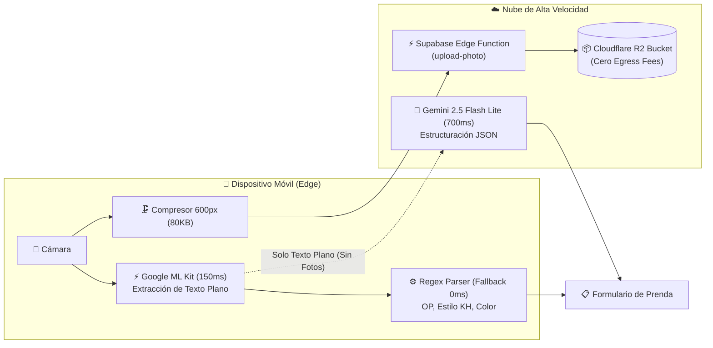
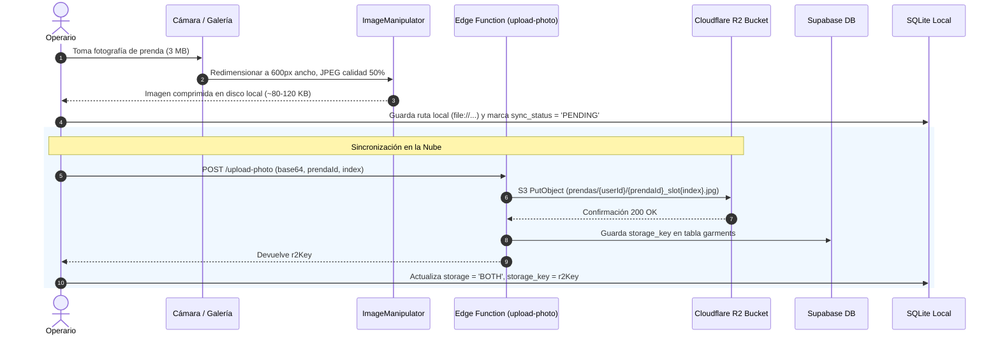

# Manual de Inteligencia Artificial, OCR y Multimedia — Topytop Kith

## 1. Visión General de la Inteligencia Artificial

Topytop Kith implementa una arquitectura híbrida de Inteligencia Artificial optimizada para entornos industriales:
1. **Reconocimiento Óptico de Caracteres (OCR Híbrido):** Extracción instantánea de etiquetas de prendas textiles combinando visión en el dispositivo y procesamiento de lenguaje estructurado en la nube.
2. **Asistente Conversacional Inteligente:** Búsqueda y trazabilidad en lenguaje natural conectada directamente a la base de datos local SQLite.
3. **Pipeline de Multimedia de Cero Costo de Egress:** Almacenamiento y compresión de fotografías combinando Supabase Edge Functions y Cloudflare R2.



---

## 2. Pipeline de OCR Híbrido

### 2.1. El Desafío de la Visión Tradicional
Subir fotografías de alta resolución (3-6 MB) a APIs de visión en la nube consume demasiado ancho de banda, añade latencias de 4 a 8 segundos y bloquea al operario si la señal WiFi en almacén es inestable.

### 2.2. La Solución: Pipeline en Tres Etapas

#### Etapa 1: Visión Nativa en el Dispositivo (Google ML Kit)
* **Librería:** `@react-native-ml-kit/text-recognition`
* **Tiempo de Ejecución:** ~120 - 180 ms.
* **Consumo de Red:** **0 KB** (100% Offline).
* **Función:** Analiza la imagen localmente utilizando los aceleradores neuronales (NPU/GPU) del teléfono y entrega un volcado de texto plano con los caracteres detectados.

#### Etapa 2: Estructuración con Gemini 2.5 Flash Lite (`GeminiTextOCRService`)
* **Modelo:** `gemini-2.5-flash-lite` (vía SDK oficial `@google/genai`).
* **Tiempo de Respuesta:** ~600 - 800 ms.
* **Carga de Red:** Solo unos cientos de bytes de texto (nunca la imagen pesada).
* **Timeout de Seguridad:** 3.0 segundos (`Promise.race`).
* **Prompt de Sistema:**
  ```text
  Extrae prendas del texto OCR de inventario textil.
  Devuelve solo JSON con este formato: [{"op":"","style":"","color":""}].
  Reglas: op tiene 4-10 dígitos o queda vacío; style empieza con KH; corrige O/Q→0 e I/L→1 en números; color va en mayúsculas o "S/C". Conserva el orden del texto. Si no hay prendas, devuelve [].
  ```
* **Ventaja:** Corrige inteligentemente errores de impresión, etiquetas dobladas y caracteres ambiguos comunes en el rubro textil (ej. confundir `0` con `O`, o `1` con `I`).

#### Etapa 3: Respaldo Determinista Local (`ocrParser.ts`)
Si el dispositivo no tiene internet o la solicitud de Gemini supera los 3 segundos, la app conmuta automáticamente y sin errores a su motor de expresiones regulares local:
* **Detección de Estilo:** `/(KH[A-Z]*)\s*([0-9OQ]{3})\s*([0-9OQ]{2,3})/i`
* **Detección de OP (Orden de Producción):** `/(?:OP|O\.P\.|0P|LOTE)\s*[:\-]?\s*([0-9OQIL]{4,10})/i`
* **Normalización Numérica:** Reemplaza letras `O/Q` por `0` y letras `I/L` por `1` en las zonas numéricas de estilo y OP.
* **Extracción de Color:** Asigna el remanente de texto normalizado o `"S/C"` (Sin Color).

---

## 3. Asistente de IA y Búsqueda en Lenguaje Natural (`ChatbotService`)

La pantalla de Chatbot permite a auditores y operarios consultar el inventario hablando naturalmente, por ejemplo:
* *"¿Dónde está la prenda de estilo KH001 y color Azul?"*
* *"Muéstrame la OP 20459"*
* *"¿Qué prendas hay en la Caja 03 del Lote Verano?"*

### 3.1. Arquitectura de Procesamiento de Lenguaje Natural (NLP)
1. **Normalización Lingüística (`nlpEngine.ts`):** Convierte el texto a minúsculas, elimina tildes, signos de puntuación y palabras vacías (*stopwords*).
2. **Extracción Entitaria:**
   * **OP:** Extrae secuencias numéricas de 4 a 10 dígitos asociadas a prefijos o aisladas.
   * **Estilo:** Reconoce patrones que inician con `KH` y secuencias de modelo.
   * **Color:** Compara palabras contra el catálogo léxico textil normalizado.
3. **Puntaje de Proximidad Difusa (`fuzzyMatching.ts`):** Utiliza distancia de Levenshtein para identificar nombres de cajas aunque el usuario cometa errores tipográficos (ej. *"kja 1"* → *"Caja 01"*).
4. **Generador de Consultas SQL:** Construye dinámicamente sentencias optimizadas contra la base de datos local SQLite combinando `JOIN boxes` y `JOIN inventories`.
5. **Navegación Interactiva:** Las respuestas del chatbot renderizan tarjetas interactivas (`ChatGarmentCard`, `ChatBoxCard`). Al pulsar una tarjeta, la app navega directamente a la pantalla de contenido de la caja (`BoxContentsScreen`) resaltando la prenda solicitada.

---

## 4. Pipeline Multimedia (Cloudflare R2 + Supabase Edge Functions)

Para garantizar un almacenamiento masivo de alta resolución sin generar costos prohibitivos por transferencia de salida (*egress fees*), se utiliza Cloudflare R2 con Supabase como orquestador de metadatos.



### 4.1. Ventajas del Enfoque
* **Reducción de Almacenamiento del 97%:** De 3.5 MB originales a menos de 100 KB por imagen, manteniendo perfecta legibilidad en etiquetas y costuras textiles.
* **Cero Egress Fees:** Cloudflare R2 no cobra tarifas por descarga de datos, a diferencia de AWS S3 o Google Cloud Storage.
* **Caché Offline Automática:** Las imágenes ya descargadas se conservan en el directorio permanente del dispositivo (`FileSystem.documentDirectory`). Si no hay internet, la app las sirve localmente al instante.
