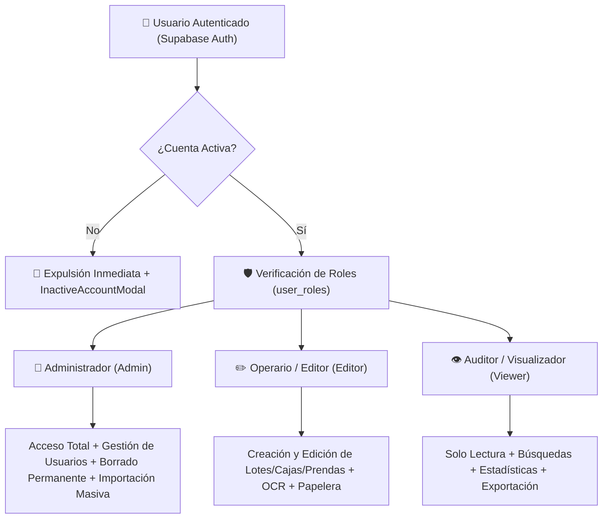

# Manual de Roles, Permisos y Seguridad — Topytop Kith

## 1. Modelo de Control de Acceso Basado en Roles (RBAC)

Topytop Kith incorpora un sistema de seguridad granular de tres niveles para garantizar que los operarios, supervisores y administradores tengan acceso exacto a las funciones que les corresponden.



---

## 2. Matriz de Permisos y Capacidades

| Módulo / Acción | Admin 👑 | Editor ✏️ | Viewer 👁️ |
| :--- | :---: | :---: | :---: |
| **Consultar Lotes, Cajas y Prendas** | ✅ | ✅ | ✅ |
| **Búsqueda Avanzada y Asistente IA** | ✅ | ✅ | ✅ |
| **Visualizar Métricas y Dashboard** | ✅ | ✅ | ✅ |
| **Exportar a Excel (XLSX)** | ✅ | ✅ | ✅ |
| **Crear y Modificar Lotes y Cajas** | ✅ | ✅ | ❌ |
| **Registrar y Editar Prendas** | ✅ | ✅ | ❌ |
| **Escanear con OCR (ML Kit / Gemini)** | ✅ | ✅ | ❌ |
| **Adjuntar y Tomar Fotografías** | ✅ | ✅ | ❌ |
| **Mover Prendas a la Papelera** | ✅ | ✅ | ❌ |
| **Restaurar Prendas de la Papelera** | ✅ | ✅ | ❌ |
| **Vaciar Papelera (Borrado Físico)** | ✅ | ❌ | ❌ |
| **Gestión de Usuarios (Asignar Roles)** | ✅ | ❌ | ❌ |
| **Suspender o Activar Cuentas** | ✅ | ❌ | ❌ |
| **Importación Masiva de Semillas (629)**| ✅ | ❌ | ❌ |

---

## 3. Implementación en Frontend: Componente `RoleGuard`

Para proteger la interfaz de usuario de manera declarativa y reactiva, se utiliza el componente [`RoleGuard`](file:///c:/Users/Deyvi/Desktop/Guardar-Cosas/Dev/Inventario_App/Inventario_frontend-App/src/components/common/RoleGuard.tsx):

```tsx
import { RoleGuard } from '../components';

// Ocultar un botón si el usuario no tiene permisos de edición
<RoleGuard requiredRole="Editor">
  <TouchableOpacity onPress={handleCreateGarment} style={styles.fab}>
    <Ionicons name="add" size={24} color="#FFF" />
  </TouchableOpacity>
</RoleGuard>

// Renderizar un reemplazo visual en modo solo lectura
<RoleGuard 
  requiredRole="Admin" 
  fallback={<Text style={styles.readOnlyNote}>Función reservada a Administradores</Text>}
>
  <Button title="Vaciar Papelera Permanentemente" onPress={handleEmptyTrash} />
</RoleGuard>
```

---

## 4. Ciclo de Vida de Cuenta y Suspensión en Tiempo Real

### 4.1. Verificación de Estado Activo (`isActive`)
Cada vez que el usuario abre la aplicación o cambia el estado de autenticación, [`AuthManager.ts`](file:///c:/Users/Deyvi/Desktop/Guardar-Cosas/Dev/Inventario_App/Inventario_frontend-App/src/services/auth/AuthManager.ts) consulta directamente a Supabase:
```ts
const roleInfo = await RoleService.getUserProfileAndRoles(currentUserId);
if (roleInfo.isActive === false) {
  // 1. Limpiar sesión y caché local SQLite
  await SynchronizationEngine.cleanLocalData(db);
  // 2. Cerrar sesión en Supabase Auth
  await supabase.auth.signOut();
  // 3. Mostrar pantalla de bloqueo InactiveAccountModal
  return;
}
```

### 4.2. Modal de Cuenta Suspendida (`InactiveAccountModal`)
Si un administrador desactiva a un operario en el panel de gestión:
1. El operario es expulsado inmediatamente de cualquier pantalla activa.
2. Los datos locales quedan purgados para evitar filtraciones de información corporativa.
3. Se despliega una ventana bloqueante informándole que su cuenta requiere autorización de un administrador para operar.

---

## 5. Seguridad de Claves y Variables de Entorno

### 5.1. Regla de Oro: Prohibido Credenciales en Código Fuente
Ninguna clave secreta, clave anónima ni URL debe estar escrita de forma fija (*hardcoded*) en el código de TypeScript. Se consumen estrictamente desde `process.env`:
* `EXPO_PUBLIC_SUPABASE_URL`: Endpoint de la instancia Supabase.
* `EXPO_PUBLIC_SUPABASE_ANON_KEY`: Clave pública de acceso cliente.
* `EXPO_PUBLIC_GEMINI_API_KEY`: Clave de acceso a la API de Google Gemini.

### 5.2. Aislamiento con `.gitignore` y `.easignore`
* **`.gitignore`:** Contiene permanentemente `.env` y `.env*.local` para garantizar que las credenciales **nunca se suban a repositorios de Git públicos o privados**.
* **`.easignore`:** Excluye carpetas pesadas (`node_modules`, `dist`), pero **permite el paso del archivo `.env` local** exclusivamente hacia la máquina virtual de compilación en la nube de Expo durante `eas build`.
